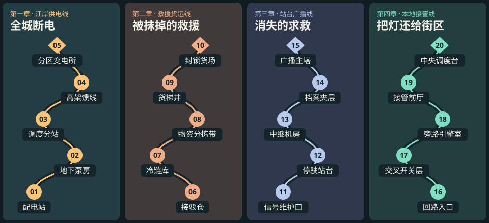

# 《夜班修理局》四章二十关开发计划

**交付范围**　从江岸配电站打到中央调度台，共 4 章、20 张主线工单。先用 03 打通新武器、弱点、第三个地图节点和旧档续玩，再用 05 验证一整章能否量产。目标游玩时间依次为 32、33、34、35 分钟，共 134 分钟。最短合格路线须实测达到 120 分钟。

**工作树基线**　01、02 已可玩，使用内容版本 21、22。01 可用扳手，首通授予电弧枪；02 已能选电弧枪，首通会把液压钉枪写进档案。钉枪的攻击和 03 尚待实现。当前选关逻辑直接绘制两个站点，选起手只识别扳手与电弧枪。以下把 01–02 当回归样本，03–20、四张完整章图、其余工具与局外成长列为制作任务。所有新增数值和人日均为首轮试制值。[关卡与档案](../creator-m0/assets/scripts/campaign/Campaign.ts) · [当前规则表](../creator-m0/assets/scripts/m1/content.ts) · [当前场景入口](../creator-m0/assets/scripts/cocos/M1Bootstrap.ts) · [剧情原案](CAMPAIGN-STORY-OUTLINE.md)

## 一、玩家从哪儿出发

主页保留唯一按钮「出勤」。进入当前章节，镜头优先对准进行中的工单，其次是第一处已开放且未修复的站，全部修复时对准 20。点未通关站查看任务、目标和起手；点进行中的站续玩；点已修复站可重刷。查看其他站点可以随时返回，只有确认开始另一局才替换当前出勤。起手、蓝图和档案入口放在工单详情或结单页。回到主页始终只见「出勤」。

| 章图与路线 | 地图上发生的变化 | 过章动作 |
| --- | --- | --- |
| 一 · 江岸供电线。由配电站过石桥，再沿高架馈线到变电所 | 沿用现有江岸构图与 01→02 的石桥；向远岸扩图容纳后三站。01 完成点亮桥灯，05 完成亮起居民楼的窗 | 05 结单后镜头沿货运支线进入接驳仓 |
| 二 · 救援货运线。码头、冷库、分拣带、竖井、货场 | 电池车从已修复站开到下一道闸口；10 完成，驶向医院的救护灯亮起 | 跟随医院发出的断续广播进入信号维护口 |
| 三 · 站台广播线。沿轨道上行，经站台、机房、档案层抵达塔顶 | 线路逐段恢复波形；15 完成时塔顶向各区发射三个同心环 | 广播里传来中央拒绝交权的回执，打开回路入口 |
| 四 · 本地接管线。进线、开关、引擎、前厅、核心 | 已接通的旁路在同一张图上持续点亮；20 完成后全图从应急灯切换到分区照明 | 返回可重刷的章图；港区来信进档案，首篇到此结案 |

**落地规格**　每章一个纵向可滚动地图，在 360 宽设计坐标上排五个站，第一站靠近景、第五站靠远景。建议美术画布 720 × 2080，运行时按两张 720 × 1040 拼接。节点、道路折点和地标锚点共用图内坐标，长屏扩大可视区域。标题、返回键固定在安全区；滚动底图和站点一起移动。按下到松开位移超过 8 设计像素视为拖图，按钮有效区至少 44 × 44。移动镜头前保存章内位置。章末可点上一章或已开放的下一章；锁章显示具体前置工单。闪电及呼吸圈表示当前可出勤，锁带前置编号，勾带「已修复」，续玩标波次。复电效果读档重建。示意图表示空间顺序，最终锚点随画稿标定。

## 二、逐关生产单

表内 W1–W6 是玩家看到的波次。前五波之间保留整备，第六波收尾；同一行的敌群按出场先后阅读。所有非首关以相邻上一关首通为前置，任何一关重玩都可再次完成该关目标。首通除表内注明的工具外，均记录线索并开启下一站；20 改为结案。进行中目标、敌人和地标在以下四章使用同一个稳定关号。

### 第一章 · 全城断电（32 分钟）

| 工单 | W1–2 教会什么 | W3–5 怎么加压 | W6 胜利条件与首通结果 |
| --- | --- | --- | --- |
| 01 配电站 · 6 分 | 单独爬虫练点地走位，第二波加入冲车，首店给配对 | 炮台封路，装甲机入场，再混编；引导绕到护甲侧后 | 限时击败巡检机。日志证明本区是主动切电；授电弧枪 |
| 02 地下泵房 · 6 分 | 首波教单水区预警，第二波单练冲车 | 双水区错相通电，依次加冲车、炮台、装甲；留中线供横切 | 双水区中击败巡检机。对齐泵压记录与切电时间，发现命令早于报警；授液压钉枪 |
| 03 调度分站 · 6 分 | 一台装甲机显露侧后弱点；第二波让一台炮台躲在它身后 | 双侧入场，盾列转向有停顿；第五波增加冲车，横移可让护甲离开射线 | 击败分站主管。每次发令后核心暴露 2.4 秒，扳手绕背、钉枪从正面打窗口均可。回执标出中央签发源 |
| 04 高架馈线 · 7 分 | 先亮即将关闭的检修道，第二波只加一台追击机 | 长直道让追击机加速，拐弯让它掉队；炮台先封一侧，另一侧留出口 | 在两条道各合闸一次，再击败领队。馈线电表显示能量进入零号线路 |
| 05 分区变电所 · 7 分 | 分两波教 A/B 供电和对侧断电；先只放爬虫 | 盾列、炮台错峰，换区后追击机补位；第五波先演示一次守门机的闸刀预警 | 切换 A/B、打掉并联守门机。居民一线复电，阿阮收到医院备用电源告急；授脉冲喷管 |

### 第二章 · 被抹掉的救援（33 分钟）

| 工单 | W1–2 教会什么 | W3–5 怎么加压 | W6 胜利条件与首通结果 |
| --- | --- | --- | --- |
| 06 接驳仓 · 6 分 | 靠近电池车发车，离开即驻停；单侧冲车试探车道 | 回收爪第一次单独拽车；随后由货架两侧错峰来敌，近身喷管可守车头 | 电池车抵达第三道闸、击败回收班长。扫描货签，救援物资已被改列为可回收资产 |
| 07 冷链库 · 6 分 | 灯带提前指向下一处保温区；第一次换区只遇爬虫 | 冲车逼出保温区，炮台延迟压另一侧；先回补保温再去捡件 | 在三个保温区各完成一次稳压，拆掉制冷护卫。出库记录显示医院的配送优先级已被调低 |
| 08 物资分拣带 · 7 分 | 空带演示反向箭头，第二波让爬虫被送到玩家面前 | 炮台瞄准落点、回收爪从下游牵引；用侧边步道换线 | 完成两次分流，把电池送进人工出口后击败分拣领班。优先规则上有陈栖的签名 |
| 09 货梯井 · 7 分 | 站上平台启动一层，离开拆掉卡梯中继再回来 | 平台停靠三层；第三层回收爪威胁平台，远程与近战分批到场 | 停梯、拆最后一座锁梯中继，再回平台护送到顶。取得手动覆盖方案，读到双份授权要求 |
| 10 封锁货场 · 7 分 | 练习横切拖索、拦在车与回收口之间 | 两个回收口交替开启；先有随车冲锋，再加后排炮台，不同时闭合两条截线 | 击败拖拽回收车且电池尚可交付。电池分配给医院与泵站，从交接终端取得第一份授权；授牵引线圈 |

### 第三章 · 消失的求救（34 分钟）

| 工单 | W1–2 教会什么 | W3–5 怎么加压 | W6 胜利条件与首通结果 |
| --- | --- | --- | --- |
| 11 信号维护口 · 6 分 | 一束扫描灯扫出可接通扇区；第二波加单台干扰机 | 干扰机令当前接通暂停，先离开再拆机；炮台和追击机轮替 | 在三个扇区完成握手，击败屏蔽领队。接收器解码出被标记为重复噪声的求救包 |
| 12 停驶站台 · 7 分 | 阴影里有脚灯预兆，扫描光一经过就显出埋伏机 | 双轨分批显形，护甲机隔开视线；用牵引拆开编队或绕到亮区 | 守住站台录音端并击败最后一对埋伏机。阿阮带回乘客原始求救，与广播日志核对 |
| 13 中继机房 · 7 分 | 给 A 上电后转 B，首轮没有干扰；第二波引入定向炮台 | 通电端吸引炮火，需错位引弹；第四波起干扰机与盾机结组 | A、B 各完成两段上传，再击败守端精英。两份日志证明系统把总供电量排在求救之前 |
| 14 档案夹层 · 7 分 | 离开档案端有短暂回连宽限；第二波演示回环路线 | 护甲编队守窄口，追击机绕后；保回传时必须穿过走廊另一端 | 三段校验完成，击败档案守卫。陈栖出示十分钟有效的应急规则与被系统拒绝的撤销回执 |
| 15 广播主塔 · 7 分 | 修一根天线，看清扇区预警和开放扇区 | 两根天线轮流掉线；干扰机先到、冲车后到，第五波预演顺时针换扇区 | 接回天线、击败静默阵列。广播发出真实求救，收齐第二份授权；授分束探针 |

### 第四章 · 把灯还给街区（35 分钟）

| 工单 | W1–2 教会什么 | W3–5 怎么加压 | W6 胜利条件与首通结果 |
| --- | --- | --- | --- |
| 16 回路入口 · 6 分 | 主动切断左回路，亲眼看见右回路可通行；第二波交换 | 带电区配冲车，换线后装甲掩护炮台；保留回头的安全带 | 在交替供电下拆掉封路精英，接入中央端口。两份授权仍被中央拒绝，必须建立本地旁路 |
| 17 交叉开关层 · 7 分 | 先给中继上电，再护送电池车穿过路口 | 两轮路口换序，回收爪盯车、干扰机盯灯；按场上标识决定先守哪边 | 车抵双闸末端且两端有电，击败路口领队。列出可以先切本地电源的街区 |
| 18 旁路引擎室 · 7 分 | 单侧旁路先建立回路，观察负载向另一侧转移 | 装甲护送干扰机，追击机走短路；两侧先后告警，引怪绕中央引擎 | 左右旁路各承受两次负载并击败破坏机。陈栖留下维持引擎，阿阮通知街区接管 |
| 19 接管前厅 · 7 分 | 依次校验医院签发端和广播端，先分别教守点 | 近战冲一端、炮台封另一端，警报错峰；分束可覆盖两向，扳手可绕中心截击 | 在同一轮有效期内完成两端校验，击败守厅精英。两份签名同时生效，核心维护门开启 |
| 20 中央调度台 · 8 分 | 扇区封锁、拦截回收各做一次，唤起前章经验 | 依次预演两区切换、混编护端、最后一组旁路接管；整备后进核心 | 破除封区与拖拽、打停调度核心并完成接管。街区自行复电，终幕亮灯，港区回信入档；授旁路扳手供重玩 |

**编剧交接。** 01–04 让玩家依次拿到操作日志、时间戳、签发地址和能流读数。05 恢复的是居民一线，医院仍靠备用电，06 的护送因此成立。08 的签名只证明陈栖制定过优先规则；14 的原始规则与撤销回执才解释他的责任。10 的医院交接记录和 15 的广播联络记录分别证明物资已到、街区已收到指令。两份记录授权在本地机柜执行覆盖，16 从远端提交仍被中央拒绝，所以要在 17–19 铺旁路并到前厅双签。20 先停强制切电，再由阿阮确认各区接手，最后才亮全城灯。港区来信只提供后续线索。

## 三、战斗数值与难度

固定模拟频率 30 Hz，设计战场 330 × 400，维修工移速 156 像素/秒，战役基础生命 10，一次受伤扣 1、保护 43 tick，每波重置生命。现有全局容量是 36 个敌人及出场预警合计、40 枚敌弹。扩章先固定这些基础值。玩家点可行走位置寻路，到点停下；目标靠接近、占位或自动攻击激活。新增实体障碍先实现可行走网格、最近可达落点与沿途绕行，否则 04 双道和 18 环形机房不能开工。[战斗步进](../creator-m0/assets/scripts/m1/Battle.ts) · [基础参数](../creator-m0/assets/scripts/m1/content.ts)

### 敌人从单独读招到组合拆解

| 原型、首教 | 生命／常速（像素/秒） | 可观察的动作、反制及升级 |
| --- | --- | --- |
| 慢爬虫、冲车、炮台、装甲机，01 | 4/47、6/35、5/24、7/34，现值 | 爬虫占空间；冲车锁方向后横移；炮管亮起后移出射线；装甲正面常规受伤乘 0.4，侧后吃满。先分波亮相再混编。03 的挡弹编队需新增弹道遮挡和绕背暴露判定 |
| 追击机，04 | 5/56，直线追踪 1.2 秒后加至 82 | 双轮拉长轮迹，锁一段直线才加速；转过直角要重新提速。04 单体追，05 换区后补位，18 与盾队并路 |
| 回收爪，06 | 8/30，牵引半径 72 | 黄缆先投影 0.9 秒，再牵车 2 秒。横穿缆身或打爪可断，车失去一段推进但仍有追赶窗口。08 与输送方向叠加，10 升为双口 Boss |
| 干扰机，11 | 6/32，干扰圈半径 52 | 三角天线展开，0.9 秒后中继读条暂停；离开干扰区、击退或拆机可解除。13 才让护甲伴行，17 再让它与车分两处行动 |
| 埋伏机，12 | 5/45，显形预警至少 0.9 秒 | 黑暗中保留脚灯，首轮扫描必照亮出入口；出手前显形并持续可打 3 秒。借扫光判断方向，15 用它检验玩家是否会边换扇区边看灯 |

普通关领队优先复用当章已教过的底盘、动作与预警，一个精英最多新增一种弱点或队形指令。03 主管首测 58 生命；其余普通关关底单精英按章从 60、70、80、90 生命起测。双精英共享该关预算，单只取 55%。优先调出场顺序、射线角度、暴露窗口，再调生命。第四章复用三章敌谱，增加跨目标决策。

### 波次时长与刷怪表

下表将 20 关逐一落到时钟。战斗／目标时间包括一边守点一边战斗的重叠时段，只记一次。已有波表填真实时限；W6 的预期击破时间与硬超时分别列出。其余为首测预算，目标完成后可提前收波。整备预算是全关主动挑选、对比和装配的合计，玩家随时可以跳过。

| 节奏 | W1–5 预算（秒） | W6 有效／硬超时（秒） | 全关主动整备（秒） | 合计 |
| --- | --- | --- | --- | --- |
| 配电站 | 30/40/45/55/60 | 50/75 | 80 | 360 秒 |
| 地下泵房 | 42/48/50/55/60 | 55/75 | 50 | 360 秒 |
| 六分工单 | 35/40/45/52/58 | 65/100 | 65 | 360 秒 |
| 七分工单 | 40/48/55/62/65 | 85/115 | 65 | 420 秒 |
| 终局工单 | 45/55/63/70/77 | 108/145 | 62 | 480 秒 |

| 关号 | 节奏 | W1–5 基础出怪间隔（tick/只） | 同屏控制与峰值安排 |
| --- | --- | --- | --- |
| 01 | 配电站 | 37/32/29/34/31 | 现行全局上限 36；前四波逐只引入新类型 |
| 02 | 地下泵房 | 42/36/39/36/33 | 现行上限 36；两侧水区半径 48，预警 24 tick，通电 45 tick，两区错开 75 tick |
| 03 | 六分工单 | 42/40/38/36/34 | 提案上限 12；一个盾列配一座炮，先出盾 |
| 04 | 七分工单 | 43/40/36/34/32 | 13；单通道最多一条冲刺预警 |
| 05 | 七分工单 | 42/38/36/33/32 | 14；切区时停止刷炮 2 秒 |
| 06 | 六分工单 | 46/42/39/36/34 | 12；首段护送只从车前出敌 |
| 07 | 六分工单 | 42/40/37/34/32 | 14；下一保温区亮起时至少一侧无冲车 |
| 08 | 七分工单 | 42/38/35/33/31 | 15；换带前后各 1 秒禁刷落点炮 |
| 09 | 七分工单 | 40/38/35/32/30 | 16；清完梯口旧队再出下一层 |
| 10 | 七分工单 | 42/38/35/32/30 | 16；拖索期间同时至多一台普通回收爪 |
| 11 | 六分工单 | 46/42/39/36/34 | 14；干扰机先单独进场一个周期 |
| 12 | 七分工单 | 43/39/36/33/31 | 16；最多两台待显形敌机 |
| 13 | 七分工单 | 42/38/35/32/30 | 17；盾炮组合只占一个端口 |
| 14 | 七分工单 | 40/37/34/32/30 | 18；追兵晚于正面护甲 1.5 秒 |
| 15 | 七分工单 | 42/38/35/32/30 | 18；换扇区时暂停埋伏机出手 |
| 16 | 六分工单 | 44/40/37/34/32 | 16；首次主动切电时仅一台冲车 |
| 17 | 七分工单 | 42/38/35/32/30 | 18；车道与中继的重预警间隔至少 1.2 秒 |
| 18 | 七分工单 | 40/37/34/31/29 | 19；两个端口的负载错开至少 3 秒 |
| 19 | 七分工单 | 40/36/33/30/28 | 20；首轮双签无远程封口 |
| 20 | 终局工单 | 42/38/34/31/29 | 20；终幕接管阶段先减到最多 8 只支援机 |

**怎样配每波。** 现有 01、02 直接保留敌人序列。新关的首次教学以 3 只爬虫配 1 只新敌为一组；中段试用「2 爬、1 近战、1 远程或目标敌」，峰段试用「2 爬、1 近战、1 护甲、1 远程、1 目标敌」，用生产单的原型替换。狭道和护送关的特别限制优先。调平时按爬虫 1、冲车／追击／埋伏 2、炮台／护甲／回收爪／干扰机 3 计算每 30 秒入场威胁；例：03 每 40 tick 出 1 只时，3 爬 1 甲均值 1.5，约 34 点/30 秒。上限满就延后增援，记录实际入场数。每章首关先降低密度教规则，末两关再叠组合。

**目标判定。** 初版供电点半径 30，累计站入 2 秒算合闸；车有 6 格耐久，玩家距车 ≤65 时以 32 像素/秒推进，抵达站点写入任务状态；中继有 5 格耐久，连续守住一个 8 秒周期完成一段。护送或中继受击宽限 1.5 秒，耐久为零明确标出任务失败。14 回传容许离端 2.5 秒，超时只退当前段；19 第一次校验后留 12 秒穿越至另一端。新目标普通波到时仍未完成则报告具体未达条件。W6 同时检查本关目标与关底存活状态。提前完成即结算，暂停冻结所有时钟，换波恢复本波规定的目标初态或已提交的跨波进度。

| 场地机制 | 首测参数 | 调试时专看 |
| --- | --- | --- |
| 04 双检修道、16 主动切线 | 04 每 8 秒换道、提前 1.2 秒亮箭头；16 由玩家合闸触发，切电后留 1 秒缓冲 | 点对岸后中途关闸应重算路线；出生点、目标和至少一个撤离点始终连通 |
| 07 保温区、08 输送带 | 保温槽 6 格，离开有效区每 4 秒扣 1 格，入区每 2 秒回 1；新旧区重叠开放 1.2 秒。输送带侧推 26 px/秒，每 8 秒反向、提前 1 秒闪箭头 | 掉温归零显示失温；带上松手后仍受传送带推动，点向侧步道能以基础速度脱离 |
| 09 货梯、11 扫描扇区 | 每层停梯后才展开侧桥；回梯范围半径 36。扫描扇区宽 90°，每 6 秒换一格，下一格提前 1 秒标出 | 梯门开启前不刷桥外近战；握手与换扇区同帧发生时先判本段完成 |
| 12 搜索灯、13 双端供电 | 搜索灯 4 秒扫完半场，伏兵先显形再攻击；双端交替上电的过渡宽限 3 秒 | 站在起点能看到第一次显形；两端即使受干扰也保留已提交的上传段数 |
| 17–20 复合任务 | 车到路口前 1.2 秒发路权灯；18 双侧负载各持续 6 秒；19 签名只回退本轮；20 停机后撤去致伤区再开始 3 秒接管 | 任何时刻 HUD 只写当前可执行动作；日志记录哪一个目标导致成功或失败 |

### 章末 Boss 的首轮参数

| 工单／生命 | 预告、阶段与安全解 | 可用武器与验收 |
| --- | --- | --- |
| 05 并联守门机／92 | 闸刀落下前亮轨 1 秒；在对侧合闸后开核心 4 秒，半血交换 A/B 顺序。两闸中心相距约 120 | 扳手追核心也能打完；故意站错侧后仍能等下一次开窗，禁止两侧同时致伤 |
| 10 拖拽回收车／104 | 提钩 1.1 秒后锁索，横穿可断；断索后停机 4.5 秒，半血交替左右回收口 | 喷管清近卫、扳手靠截线救车。单次漏截仅损车 1 格，同时检查击破、车损归零两种结单 |
| 15 静默阵列／110 | 6 个扇区中始终留相邻 2 区；预警 1.2 秒后封锁，接回天线暴露主机 5 秒，半血后换区方向反转 | 线圈可散开守塔敌，扳手可转身找安全区。静音、灰阶也能从地纹读出下一安全区 |
| 20 调度核心／128 | 生命 70% 和 35% 各切一次阶段。先接通开放扇区，再断索，最后守双端；两次交互后各露核 5 秒，末段持续可伤，打停后需在中央接管 3 秒 | 探针照顾双线，扳手可依次截击。接管前不发奖，双签成立后才触发终幕；致死、超时和重复接管分别验 |

测击破时间时记录「可攻击秒数、实际命中、目标数、有效伤害」。扳手裸单体理论输出约为 2 × 30 / 14 = 4.29 生命/秒；05 若基础路线单武器只有 25 秒能命中，理论最多约 107 伤害，92 生命余量很小。优先延长开窗或减少挡路增援，再重测。基础工具路线可以正常买第二把工具和模组。所有关底须同时满足该关时限与两条无广告路线可达。

## 四、武器、商店与局外成长

每局最多两把工具，每把两个模组槽。起手路线仍可选导电触点或大拾取圈，首店给对应配对件。电弧、磁吸、过热沿用各自的触发条件。现有商店铆钉枪与 02 首通液压钉枪各用独立 ID、图标和说明。01 首次开局固定扳手，02 起能选已获得且已实装的起手；规划终局工具在通关后开放重玩配装，包括回到 01 重刷。

| 首通 → 首次使用 | 工具与数值（伤害／间隔 tick／射程 px） | 更强的局面、代价与验收对照 |
| --- | --- | --- |
| 01 → 02 | 电弧枪 2/20/123，已实装。基础最多再跳 2 次、跳距 56 | 在泵房安全侧清成群敌；散开的单体上慢于扳手 2/14/104。比较两把起手的贴身时长和每击目标数 |
| 02 → 03 | 液压钉枪 4/32/155，弱点窗伤害 ×1.5，普通正面护甲倍率从 0.4 提到 0.7 | 能穿一层盾掩体，贯穿后仅再命中一只，间隔长。分别在盾列和分散爬虫上测命中数，03 用扳手绕背复测 |
| 05 → 06 | 脉冲喷管 2/23/78，前方 70°，普通敌推开 16 px | 能腾出车头，远处炮台仍需靠走位处理；同目标 1 秒内只受一次推。并排两辆冲车验证位移与预警一致 |
| 10 → 11 | 牵引线圈 2/28/98，半径内最多拉近两只、位移 20 px | 拉走挡路的护甲，代价是敌群更靠近自己；Boss 免位移、仍受伤。禁把敌人拉进墙或把守点目标拖离轨道 |
| 15 → 16 | 分束探针 2/22/140，最多两束、每条命中一个独立目标 | 双向守点覆盖好，同一目标不能叠吃两束。16 比较两路击杀、单体击破时间，第二束没有目标时直接空缺 |
| 20 → 重玩 | 旁路扳手 2/15/78，连续命中三次后下一击 5，离开近战 2 秒清计数 | 近身连击换爆发，对高压扇区风险更大。重刷 05 验证连击清零、只发一次首通工具、可自由换回旧武器 |

**两本账。** 局内零件用于买模组（3–4）、常规第二工具（5）、刷新（2）。普通首店若收入不足，补到配对件 4 加一次刷新 2。第一波选择能立刻配对，第二次整备留第二工具候选。首通武器由工单固定授予，保持稀有商店掉落独立于通关条件。

维修凭证在一局有效结算时按已完成波数 ×2 记账。例：过两波后在第三波失败得 4 张；六波胜利得 12 张。首次主动移动并在第一波存活满 15 秒、最终死在首波，可得一次性 1 张补助。退出、挂机与重复收据不触发补助。初张蓝图任选 4 张，其余各 8 张；一局最多选一张，也可空装。一个六波首通可买前两张，两次六波首通足够买齐三张并剩 4 张。在 01→02 已有旧档上只补应得的历史首通解锁；凭证从启用记账后的结算开始发放，迁移页写清。

| 蓝图 | 首测收益与代价 | 保底验证 |
| --- | --- | --- |
| 磁力拾取臂 | 拾取半径 ×1.25；波末基础回收 50%→35%。装分拣器再加 25 个百分点至 60% | 故意少捡的种子仍能买首店配对 |
| 窄束导电夹 | 成型电弧跳距 +20 px，最多再跳 3 次改为 2 次；未成型时照常 | 分散组收益高，紧密四目标组少打一只 |
| 快拆散热罩 | 过热停火 48→36 tick，基础热上限 6→5；装陶瓷护套时 8→7 | 短爆发回火快，持续射击更早停火 |

维修站页从工单整备打开，可做蓝图预览、兑换、装备和线索回看。胜利与失败收据都列凭证来源、余额和下张价格。档案事务以 runId 去重，写入首通、下一关可达性所依赖的完成标记、武器、已读线索及凭证流水；购买蓝图一次性扣款并解锁。广告复活沿用同一局 ID，回滚失败波，不能重复发凭证。可选六项委托沿用 GDD 的首波、三种构筑触发、首杀及两种胜利构筑；普通 01 后另可做加班 I/II。排在全篇可玩之后，奖励徽记与挑战资格。[成长与委托原案](GDD-v0.3.md)

## 五、战场底图与素材生产

制作四套章主题母版，交付 20 个可独立加载、截图和验收的场地组合。01 复用 `yard.jpg`，02 复用 `pump-floor.jpg`。其余 18 关用当章地面、边缘地标和独有作业物组合，章末增加专属轮廓。战斗地板建议输出 660 × 800，对应 330 × 400 的正俯视场地；建筑立面留在边缘，角色脚下留低对比纹理。下表方位以玩家屏幕为准。

| 工单 | 底图构图与独有地标 | 运行时单独绘制的物件／通行验收 |
| --- | --- | --- |
| 01 配电站 | 青灰水泥、顶边卷闸、两侧警戒带 | 调试叠层核对四边出生位；四向通行 |
| 02 地下泵房 | 压暗钢板、北墙弯管和黄铜阀 | 西侧偏下、东侧偏上两处积水轮替；水纹、感叹号、电击实圈独立，中央可通过 |
| 03 调度分站 | 江岸母版加继电器柜、侧后检修线 | 中间盾列，两侧绕背空地各宽 ≥48 px；面板开合与弱点同帧 |
| 04 高架馈线 | 暗蓝混凝土、双检修道、边缘可见低处屋顶 | 两段桥闸和直角岔口；关一侧时另一侧连通出生点与目标 |
| 05 分区变电所 | 对称瓷瓶排、中央守门机底座 | A/B 以圆点和条纹区分；两闸间可往返，不被 Boss 底座遮脚 |
| 06 接驳仓 | 仓运母版，斑驳黄线、栈板、三个装卸口 | 车轨过三闸；车头和两侧各留一条贴车路线 |
| 07 冷链库 | 霜蓝地坪、成列冷柜、顶部排风扇 | 三保温区按灯序交替；近景雾只在边缘，先见下一处灯 |
| 08 物资分拣带 | 两条并行黑胶带、斜向落料斗、侧步道 | 箭头独立动画，与实际输送速度和反向 tick 同步；步道全程可走 |
| 09 货梯井 | 平台格栅、井壁层号牌、边缘卷扬轮 | 平台停靠时展开侧桥；中继可达，停梯与开梯均有返回路径 |
| 10 封锁货场 | 叉车黄地坪、双回收口、大型绞盘剪影 | 电池车、挂钩、绳段和断索闪光各一层；截线不能压在 HUD 下 |
| 11 信号维护口 | 广播母版，紫灰防滑纹、检修天线和导波槽 | 扫描扇叶和干扰圈分开，握手台触区与灯座对齐 |
| 12 停驶站台 | 双轨、待机列车边缘、顶灯罩 | 扫光、脚灯、伏兵显形分别独立；灯灭仍能区分落点与轨缝 |
| 13 中继机房 | 两排机柜、端口分列左右、中央走廊 | 两端供电读条和炮线独立；可循中央廊往返，亮端不遮预警 |
| 14 档案夹层 | 矮柜、环廊、面向出口的读卡端 | 连接圈、回连宽限、回传条与护甲朝向分层；环廊有两条回端路径 |
| 15 广播主塔 | 圆形台面、三根天线、远处城市灯线 | 封区纹、天线断开与接通效果分层；可用扇区横跨边界仍可读 |
| 16 回路入口 | 控制区母版，深铅灰绝缘砖、两股铜排 | 左右回路采用不同线型；断一侧即显另一侧可走区域 |
| 17 交叉开关层 | 十字车轨、两只开关箱、短路口 | 车和端口路权独立显示；站在路口中央可看见两端预警 |
| 18 旁路引擎室 | 中央圆引擎、双旁路、外侧环道 | 实体引擎阻挡寻路，负载箭头独立；同一落点由两侧出发都可达 |
| 19 接管前厅 | 双签名端柱、隔离栏和中央门 | 两端用医院十字／广播天线符号区分；有效期可由基础移速完成 |
| 20 中央调度台 | 核心底座、外圈分区母线、远景城市轮廓 | 重用闸、索、端口组件；核心熄灭、分区亮起与全城复电按接管事件播放 |

**图层和交接。** 底图只承担材质、静态地标与光照。碰撞网格、出生区、目标轨道、预警形状、受击帧、字幕由引擎驱动。中线安全带起测宽 ≥44 px，角色边缘余量沿用 10 px，针对 04/09/18 检查点按障碍另一侧、拖动改向和窄道擦边。供电格用纹理，移动安全区用箭头，作业点用符号，三类都能静音识别。每章冻结一关灰盒 → 浏览器实点 → 同种子换皮 → 截图叠判定层，再批量铺关。

| 美术包 | 数量与复用 | 签收样本 |
| --- | --- | --- |
| 选关与场地 | 4 幅章图、20 个站点锚、4 套地面组件、20 份场地布置、4 个章末专件 | 360 × 640 与 393 × 852 各留新档、续玩、重刷截图；滚动后点地标仍进入正确工单 |
| 角色与敌机 | 维修工及现有 4 普通敌和巡检机沿用；增 4 个行为变体外形与 4 个章末 Boss 轮廓 | 每个新增单位提供静止／移动、蓄力、出手、恢复或破绽姿态；埋伏额外提供脚灯、显形，回收爪额外提供钩索；逐帧核对朝向 |
| 工具与成长 | 6 个首通武器图标及对应出手效果、3 张蓝图、凭证和六项委托标识；商品复用已有 12 枚模组 | 在 48 px 认出工具家族，区分钉枪与铆钉枪；实际命中方向与特效方向一致 |
| 叙事与反馈 | 20 份开场、20 份结单、8 次电台、阿阮和陈栖各一头像、1 幅复电终幕；现有两张工单插画复用，后续取本章地标裁图 | 电台触发点按 04/05、09/10、14/15、19/20 配置。首条给任务，第二条交代结果；首通回执可重看，跳过对白照常写档 |
| 音效与工程 | 复用现有提示与冲锋音；新增合闸、断索、接通、双签、复电五个事件音 | 每章单独加载，可退回灰盒。登记资源 ID、图源或生成记录、派生关系、许可、哈希及 Creator meta；低端机测首次加载和两关连续切换 |

现有角色图集和场景可作为美术母版。[美术清单](MECHANICAL-ART.md) · [源图记录](../art/workshop/prompts.md) · [江岸地图浏览器样本](review/campaign-roadmap.webp)

## 六、工程拆分与排期

**配置先于量产。** 使用同一 Campaign 场景和通用战斗宿主。运行时关卡表以现有字符串关号 `01`–`20` 为键，分别引用章、先修关、章图锚点、场地、波表、目标、关底、事件和首通奖。保留 01、02 的键和版本 21、22；后续初版预留 23–40。独立难度使用独立规则版本。标题、起手白名单、目标与弱点、结单、图标、剧情都经注册表查询。CI 拦截孤立节点、重复版本、缺失素材、不可获得奖励、01–20 以外的结束节点误接主线。测试用注入的三站目录替换现有两站目录，确认地图、冷启、开局和奖励不会回落到 01。

**保存点。** 将关内种子、波、商店、角色装配与目标快照放在 runId 下；跨波车辆血量／路径段、中继进度、双端校验位和 Boss 阶段按实际恢复粒度入档。战斗中杀进程回到最近提交的波初，整备中恢复已提交的购买。主档扩展字段走旧版读取、补默认值、校验、写入新槽、读回核验。01/02 真存档保留解锁与进行中出勤，02 已得钉枪的账号进 03 即可装备。坏档保持可重试，重放胜利回执幂等。云档按技术方案另做两机与冲突试验，立项时先核实 AppID 权限。[存档与云档方案](TECHNICAL-DESIGN-v0.2.md)

**任务与复活。** 四种任务模板分别实现生存清波、供电切区、护送和中继防守；冷链、双签和回传由模板参数组合。目标事件与战斗 tick 同步；皮肤订阅事件。广告只在已启用工单第 2–5 波非关底战生命耗尽、未成功复活且广告可用时提供一次，自愿回到波初。任务耐久归零和超时直接结单。护送／中继波先验证快照还原，再开放复活。失败回调可直接结算，重复回调只消费一次机会。真实广告资格、云档可用性与本地全篇可玩分别记录。

下表为剩余工作的首轮估算，共 **60–92 人日**，按角色实际投入相加。假设使用现有 Creator 工程、素材母版和 01/02 本地档，核心职责为玩法程序、关卡／数值、2D 美术／UI、测试；可一人兼任。人员配置、并行程度、外部账号等待和 05 的实测吞吐决定日历工期。每批通过出口再批量复制。

| 批次与前置 | 负责人、人日 | 本批交付 | 出口与可复核证据 |
| --- | --- | --- | --- |
| A　01/02 基线与内容目录 | 玩法＋测试，4–6 | 固化旧档和固定种子，数据驱动地图与选装，计时与调试选波，迁移骨架 | 新档、02 整备档、双通档都能进正确节点；新增第三站只改内容条目和资源引用 |
| B　03 垂直切片，依赖 A | 玩法＋关卡＋美术，5–8 | 钉枪、盾列遮挡、主管弱点、分站地图节点与底图 | 扳手绕背和钉枪开窗各通 03；02 老档开局能装备钉枪；两端各恢复一次整备 |
| C　04–05 首章封版，依赖 B | 关卡＋玩法＋美术＋测试，8–12 | 通路网格与点按绕障、双区供电、追击机、守门机、路线长图、武器奖励 | 01→05 一气跑通并可回刷；章末复电。记录实耗人日、坏种子、章时，重估 D–F |
| D　06–10 仓运章，依赖 C | 玩法＋关卡＋美术，10–15 | 护送模板、回收爪、输送带与升降机、拖拽 Boss、牵引线圈 | 车损或交付两种结单，09 出入平台无软锁；10 授权一落档，进 11 仍可回看 |
| E　11–15 广播章，依赖 D 的交章档 | 关卡＋玩法＋美术，10–15 | 中继与回连、扫描显形、两类新敌、静默阵列、分束探针 | 静音读安全区，断开重连读条可恢复；广播发出且只记录一次授权二 |
| F　16–20 接管章，依赖 D/E | 关卡＋玩法＋美术＋测试，12–18 | 复合任务、双签、核心三阶段、终幕、结局后扳手及全图回刷 | 基础路线逐一完成复合目标；20 首通写结案，重刷不重复授奖；港区无可误点的下一主线 |
| G　局外闭环／平台接口，A 后可并行 | 系统程序＋UI＋测试，5–8 | 凭证台账、三张蓝图、档案、广告适配与开关；云档接入验证 | 失败补助、购买双击、强退、广告乱序／无填充、两机档案冲突均有复测单；实际资质阻塞单列 |
| H　发布候选，依赖 F/G | 测试＋数值＋美术，6–10 | 无广告快路线、两端整篇、浏览器长短屏图、压力帧耗与可读性修订 | 提交下列放行记录。时长或软锁未过则回对应关重做，保留种子和前后对照 |

**第一批可直接领取的工单。** 程序先把 01/02 的注册表接到开局、地图、存档和结单四个入口；关卡策划用 03 对照表搭「盾在前、炮在后」的无障碍灰盒；美术同时交钉枪枪口、护甲侧窗和分站走廊；测试保留一份 02 首通旧档，从冷启动连续跑「出勤 → 03 → 选钉枪 → 弱点击破 → 回地图」。这条通过以后再扩大敌种和章图。

## 七、验收与改数顺序

| 交付门槛 | 采证方法与处理 |
| --- | --- |
| 内容完整与可恢复 | 每章 5 站，首通只开相邻下一站，跨章同规则。依次核对 20 次首通、6 次授武器、4 次章末、20 关重刷。存档故障分别放在胜利快照之后、局外事务提交中、收据显示前，验证只到账一次；20 的结案不可因回刷旧关而消失 |
| 关卡可解与公平 | 每关先用固定 10 个种子，按基础扳手与当期可用首通武器各跑一条普通无广告路线；全程可使用正常商店。记录出怪峰值、死因、受伤源、撤离距离、目标耐久与首店最低收入。自动策略失败附回放，由人复现区分策略失误与必死局。出现找不到可达作业点、双侧同封或基础路线无伤害窗口即退回 |
| 路线图与战场可读 | 浏览器先验 360 × 640 和 393 × 852。对四章都测拖图／点站、锁定／进行中／重刷／结章、缩放和冷启定位。每关同一种子截教学、压力峰、结单三帧；叠判定层核对底图墙、角色落点、地面预警与触区，在静音和灰阶下复看。真机测触控、抖音胶囊和后台恢复 |
| 134 分钟预算与两小时放行 | 两名熟悉玩法的测试者分别走基础起手和正常解锁起手。新档无广告、跳过可跳对白、不刷关。逐关把成功尝试的有效战斗、独立目标操作、主动整备记入互斥时间桶；失败、加载、暂停、无输入等待单列。两条线路取较短者，**≥120 分钟**。若不够，定位节奏缺口，在问题关增加能改变走位的有效遭遇再测 |
| 经济与剧情 | 每件武器核对授予关、下一次可装备、优劣场景；三张蓝图逐一与空装比较。8–12 人无广告小样，至少半数初接触肉鸽；记录无提示过首波 ≥75%、能说清首店意图 ≥2/3、01 首通者主动开 02 ≥1/2 并列分母。章末请玩家复述切电原因、电池去向、两份授权来源及谁最终控制供电 |
| 设备与发布 | 中档 Android 和 iOS 各从新档跑完 01–20，测连玩两关稳定 30 FPS 目标、最复杂波帧耗、峰值内存、章包加载和断网回退。用正式测试位核对展示、完成、复活提交。云档和广告分别登记账号、版本、结果；内容验收、平台上线、商业投放各自签收 |

每次改关保留关号／版本、种子、起手、蓝图、首通奖励前后值与用时。先修目标软锁和不可读预警，再调出怪组合、暴露窗与动线，最后调生命和价格。这样同一个坏种子能说明究竟改好了什么。
