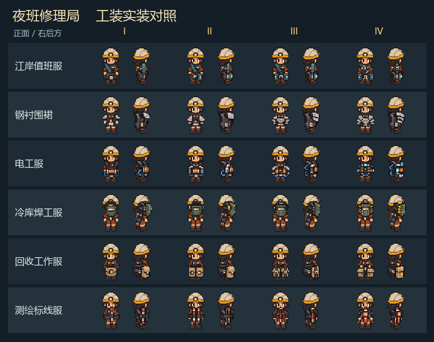

# 工装平衡与首通验收

《夜班修理局》微信首发前候选版，2026-11-28。战斗数值、存档与商品池取自当前工作区。

## 六套工装的实战取舍

六套工装、四阶、三种武器配置、五个场景和 30 个配对种子共 **10,800 局短场景**。三种配置分别为单扳手、共同的「扳手＋电弧枪＋焊枪」和各套的代表构筑。所有工装均运行相同场景、种子和输入策略。后排场景使用同位置、同耐久的四个训练目标，统计距离角色至少 175 场地单位的两台目标实际掉血。

下表为 I 阶共同构筑的 30 种子均值。购买力按本局已收回铜件、结转铜件和回收属性除以本套价格系数计算；它是采购能力估计。伤害、击毁、路程直接读取战斗。

| 工装 | 单体伤害 | 密群击毁数 | 转场路程 | 购买力 | 后排实伤 |
| --- | ---: | ---: | ---: | ---: | ---: |
| 江岸值班服 | 3983.6 | 23.3 | 2912.2 | 34.6 | 1262.4 |
| 阿阮的电工服 | 4348.8 | 23.5 | 2912.2 | 30.4 | 2995.6 |
| 老周的钢衬围裙 | 3622.6 | 23.3 | 2741.0 | 28.5 | 1140.0 |
| 冷库焊工服 | 5032.2 | 20.7 | 2912.2 | 29.0 | 1760.3 |
| 老陈的工作服 | 3089.7 | 19.7 | 2912.2 | 52.3 | 1075.6 |
| 测绘员的标线服 | 1888.4 | 16.1 | 3303.4 | 30.6 | 1140.0 |

每两套在各阶组合比较一次，共 240 对，含 60 对同阶。各指标按同种子相减，使用 29 个自由度的双侧 95% 配对区间。每对在三种构筑内分别查找双方各自优于对方的指标，排除面板移速和理论有效生命。实测伤害、剩余生命、击毁、实际路程及购买力进入判断。此次 240 对全部满足双向优势条件。该结论覆盖已测场景，区间按单项指标计算。

四章完整战役另用四个种子、六套工装各跑一局，分别通过 **24/24、20/24、23/24、18/24**。老陈的工作服在第四章这一组为 0/4。另用前三章各一次基础首通、购买六次工坊天赋的账号，以 I 阶回收服、种子 2 实际打完第四章十二波。第四章回收流前期生存值得优先做体验评审。

## 角色外观与微信资源

六套工装共用一张 128 × 960 图集，每套含四阶、五个原画方向。八方向、待机、走动和受击组合分别检查身体与工装帧、镜像方向，共 576 个组合。下图取自运行时图集，按整备人像的锚点合成。

新增工装及五把武器的 PNG 与帧描述合计 194,850 字节。工装 RGBA8 单层纹理按尺寸折算 480 KiB；设备峰值内存需要微信环境采样。

| Creator 3.8.8 候选包 | 实测结果 |
| --- | --- |
| 微信主包 / 总包 | 3,610,770 / 10,504,975 字节 |
| 四章分包，依章序 | 3,344,062 / 1,185,201 / 1,131,829 / 1,233,113 字节 |
| 微信身份与配置 | AppID 匹配，启动场景为 Campaign.scene，正式激励广告位待平台审核后接入 |
| 微信包 SHA-256 | `b4b4dd9a9ebb5ef3e2805b3795534ccb008d37c1d7ef655cd43a68b50cff9d31` |
| Web 调试包 / 非调试试玩包 SHA-256 | `0a148eb198a1e5b0baab7188a563cef9a616ec68d0c82fec41d216ccd547b157` / `f571684554cda43c80f50997d43339d0dc90457a84f0328915ef572ee8087d9f` |

## 工程验收结果

- [x] 开发自测 93/93。战斗域与 Creator 脚本均通过 TypeScript 检查，权威目录与 Creator 副本一致。
- [x] Chrome 两种触屏视口共 240/240，分别为 360 × 640 和 393 × 852。全量运行一次通过 239 项。长屏新手摇杆用例原先从按下前开始计时，机器负载高时会提前松手。改为等真实位移与引导消失后松手，同一候选包上短屏、长屏均已独立复测通过。逐例记录在本机 `log/prelaunch/launch-receipts.tsv`，截图与轨迹在同目录的 `launch-candidate` 和 `launch-joystick`。
- [x] 四章共 20 个首通节点逐格经历真实末波战斗、奖励入账、冷启动、试用与退出。试用前后存档一致。另覆盖越级、同档重打、武器改装入局、首访等待工装贴图和五处模拟广告切页防误触。
- [x] 15 把武器逐把检查特效和实伤，并在过波或失败战报核对各自的伤害与击毁。四章分别检查轨道落点、钩线、声波缺口和断路器；规则测试验证挂住废机延长侧甲窗口。
- [x] 六套工装的四阶穿着均可在整备与战斗中读取。混搭试穿提供不同武器系，高阶试穿可触发第三系补击。满阶电工线圈仅在实际续跳时亮起。

## 游戏体验待办

- [ ] 第一章首通后看江岸亮灯、抓钩演示，试用新武器。判断这一刻是否让人想再开一局。
- [ ] 在整备界面试穿钢衬围裙和测绘标线服，分别站住迎敌和绕圈布线。判断能否从主角外观与战斗反馈认出两种打法。
- [ ] 遇到拖车或调度核心时，凭预警判断该把钩线引向哪里、该踩哪块断路器。第四章可试回收工作服，判断多捡铜件的收益是否值得承担前期风险，或是否想换一套工装。

## 复核

1. 运行 `npm test` 生成无引擎的战斗模块并执行规则回归。
2. 运行 `node scripts/rig-balance.mjs` 生成 `log/prelaunch/rig-balance.json`。其中保留种子、逐项样本、配对均值差及区间；任一构筑缺失一方的优势时脚本失败。
3. 运行 `npm run sim` 复核四章十二波的完整战役。
4. 用 Creator 3.8.8 构建调试 Web 与非调试试玩包，运行 `npm run test:e2e`。成长专项在 `progression-rewards.spec.mjs`、`loadout-progression.spec.mjs`，逐把命中、Boss 预警与广告防误触沿用对应的专项用例。
